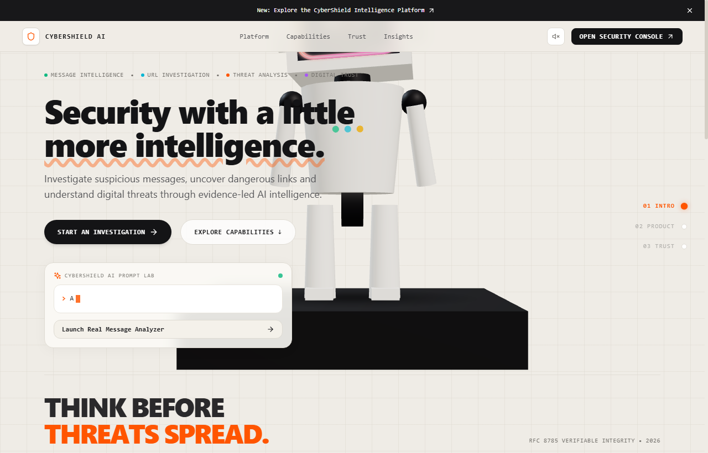
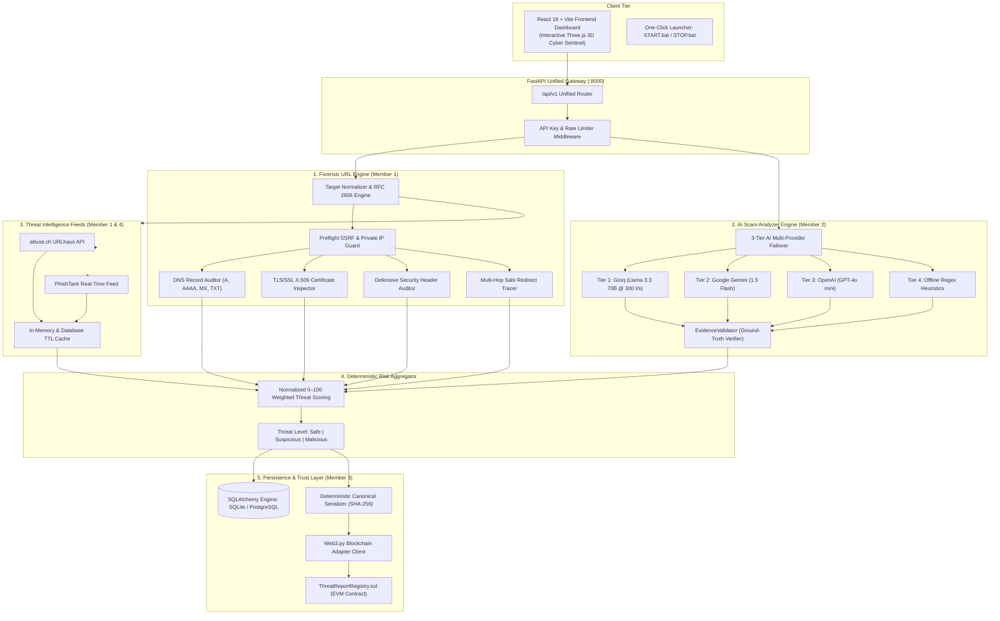

# CyberShield AI — AI-Powered Web Threat Detection & Digital Trust Intelligence

[](https://github.com/Hackathon-korboo/CyberShield-AI-Scam-Analyzer-Module/actions/workflows/ci.yml)
[](https://cybershield-ai-web-roan.vercel.app/)
[](https://cybershield-ai-api.vercel.app/)
[](docs/POST_DEPLOYMENT_TEST_REPORT.md)
[](docs/POST_DEPLOYMENT_TEST_REPORT.md)
[](frontend)
[](LICENSE)

**CyberShield AI** is an enterprise-grade cybersecurity analysis platform uniting deep technical website forensics, multi-tier AI social engineering detection, and decentralized cryptographic proof to eliminate phishing threats and guarantee audit-trail immutability.

---

## 1. Project Name and One-Line Description

**CyberShield AI**: An AI-powered zero-trust web threat detection and digital trust platform that unifies preflight network forensics, resilient multi-LLM scam analysis, and on-chain cryptographic tamper verification.

---

## 2. Problem

Modern cyber threats have evolved beyond simple signature-based matching:

- **AI-Generated Social Engineering:** Phishing emails, SMS attacks, and fraudulent messages now leverage large language models to construct contextually nuanced, grammatically flawless lures that bypass conventional spam filters.
- **Evasive Infrastructure:** Threat actors deploy short-lived throwaway domains, dynamic fast-flux DNS configurations, synthetic top-level domains, and multi-hop cloaked redirects to deceive users before security crawlers can categorize them.
- **Internal Network Exploitation (SSRF):** Inexperienced security scanning endpoints are frequently abused through Server-Side Request Forgery (SSRF) into probing cloud metadata endpoints (`169.254.169.254`) and private subnets (`10.0.0.0/8`, `192.168.0.0/16`, `127.0.0.0/8`).
- **Forensic Tampering & Centralized Audit Vulnerability:** Centralized threat reports, logs, and reputation databases are susceptible to retrospective tampering, insider manipulation, or database compromises, making post-incident forensic audits legally contestable.

---

## 3. Solution

CyberShield AI provides a deterministic, multi-layered cyber defense architecture:

- **Zero-Outbound Preflight & SSRF Guard (Member 1):** Validates every target domain before execution. It normalizes input against RFC 2606 reserved domains and blocks loopback, link-local, and private CIDR ranges to ensure external safety.
- **Deep Technical Forensic Engine (Member 1):** Audits authoritative DNS records (A, AAAA, MX, TXT), validates X.509 TLS/SSL certificate chains, inspects defensive HTTP headers (CSP, HSTS, X-Frame-Options), and traces multi-hop redirects with hop limits.
- **Resilient 3-Tier AI Scam Analyzer (Member 2):** Processes deceptive messages through an ultra-low latency multi-model failover pipeline (**Groq Llama 3.3 70B** → **Google Gemini 1.5 Flash** → **OpenAI GPT-4o-mini**) with an offline regex heuristic fallback. Features strict prompt-injection defenses and an **EvidenceValidator** that grounds AI-identified threats against exact verbatim text.
- **Global Threat Intelligence Aggregation (Member 1 & 4):** Cross-references observed targets against live feeds from **abuse.ch URLhaus** and **PhishTank** with TTL caching.
- **Decentralized Cryptographic Report Commitment (Member 3):** Generates deterministic canonical SHA-256 / Keccak-256 hashes of every threat report. Anchors proofs into an EVM smart contract (`ThreatReportRegistry.sol`) so any alteration immediately flags a verification failure.
- **Interactive Cyber Intelligence Dashboard (Member 4):** A responsive React 18 interface featuring an interactive Three.js 3D Sentinel Robot, real-time threat telemetry, scan history, and instant on-chain verification controls.

---

## 4. Demo Links and Screenshot

### Live Deployments

- **Live Web Application:** [https://cybershield-ai-web-roan.vercel.app/](https://cybershield-ai-web-roan.vercel.app/)
- **Live Production API Gateway:** [https://cybershield-ai-api.vercel.app/](https://cybershield-ai-api.vercel.app/)
- **Interactive Swagger Documentation:** [https://cybershield-ai-api.vercel.app/docs](https://cybershield-ai-api.vercel.app/docs)
- **Live System Diagnostics Endpoint:** [https://cybershield-ai-api.vercel.app/api/v1/system/status](https://cybershield-ai-api.vercel.app/api/v1/system/status)
- **Official GitHub Repository:** [https://github.com/Hackathon-korboo/CyberShield-AI-Scam-Analyzer-Module](https://github.com/Hackathon-korboo/CyberShield-AI-Scam-Analyzer-Module)

### Application Screenshot



*Figure 1: CyberShield AI production web application with interactive 3D robot interface and live threat analysis controls.*

---

## 5. Tech Stack

### Frontend Client Tier
- **Framework & Runtime:** React 18.2, Vite 5.4, TypeScript 5.2
- **3D Visualization & Graphics:** Three.js 0.187 (WebGL 3D Studio Canvas, Shader Materials, Dynamic Lighting)
- **Styling & Icons:** Tailwind CSS 3.4, Lucide React 0.359, Plus Jakarta Sans & JetBrains Mono typography
- **Data Visualization:** Recharts 2.12 (Risk distributions, metric gauges, and forensic timelines)

### Backend API Tier
- **Web Framework:** FastAPI 0.115 (Asynchronous ASGI server architecture)
- **Validation & Schemas:** Pydantic v2.7
- **HTTP & Network Client:** HTTPX 0.27 (Async connection-pooled preflight requests)
- **Database ORM:** SQLAlchemy 2.0 (SQLite zero-config local storage & PostgreSQL production support)

### AI & Threat Reasoning
- **Primary Inference:** Groq Cloud API (`llama-3.3-70b-versatile` running at 300+ tokens/sec)
- **Secondary Failover:** Google Gemini API (`gemini-1.5-flash`)
- **Tertiary Failover:** OpenAI API (`gpt-4o-mini`)
- **Offline Heuristic Engine:** Deterministic rule-based regex and pattern validator

### Threat Intelligence & Feeds
- **abuse.ch URLhaus API:** Real-time malware URL blacklist corpus
- **PhishTank Community Feed:** Verified phishing domain blacklist
- **In-Memory & Database TTL Cache:** Sub-millisecond repeat-query lookups

### Blockchain & Cryptography
- **Smart Contract Language:** Solidity 0.8.24 (`ThreatReportRegistry.sol`)
- **Development & Testing:** Hardhat 2.29, Ethers.js
- **Python Blockchain Client:** Web3.py 6.0
- **Cryptographic Hashing:** Canonical JSON serializer with SHA-256 and Keccak-256

### Infrastructure & Deployment
- **Frontend Hosting:** Vercel Global Edge Network (Single-Page App routing)
- **Backend Hosting:** Vercel Fluid Compute Serverless Functions (Python 3.12 runtime)
- **Continuous Integration:** GitHub Actions CI (`ubuntu-latest`, automated tests & builds)

---

## 6. Architecture

### System Dataflow Pipeline



### Architectural Highlights

1. **Defense-in-Depth:** Technical signals (DNS, TLS, HTTP security headers) and semantic signals (LLM message intent, urgency analysis) are calculated independently and fused deterministically into a 0–100 risk score.
2. **SSRF Neutralization:** The URL preflight resolver strictly denies access to private ranges (`127.0.0.0/8`, `10.0.0.0/8`, `172.16.0.0/12`, `192.168.0.0/16`, `169.254.169.254`).
3. **Evidence Grounding:** The AI engine refuses hallucinations; any cited suspicious phrase must exist verbatim in the analyzed message.
4. **Decentralized Immutability:** Reports committed to the blockchain registry cannot be altered by administrators, compromised database users, or attackers.

---

## 7. Setup and Run Steps

### Prerequisites
- **Git** (v2.30+)
- **Python** (v3.10 to v3.13)
- **Node.js** (v18 to v22) & **npm**

### Clone the Official Repository

```bash
git clone https://github.com/Hackathon-korboo/CyberShield-AI-Scam-Analyzer-Module.git
cd CyberShield-AI-Scam-Analyzer-Module
```

### 1. Backend Setup

```bash
cd backend
python -m venv venv

# On Windows:
.\venv\Scripts\activate
# On Linux/macOS:
# source venv/bin/activate

pip install -r requirements-dev.txt

# Create local environment configuration
copy .env.example .env   # On Windows
# cp .env.example .env   # On Linux/macOS

# Start FastAPI server
uvicorn main:app --reload --port 8000
```
- API Base: `http://127.0.0.1:8000`
- Swagger UI: `http://127.0.0.1:8000/docs`
- Health Endpoint: `http://127.0.0.1:8000/api/v1/health`

### 2. Frontend Setup

```bash
cd frontend
npm install

# Start development server
npm run dev
```
- Web Application: `http://localhost:5173`

### 3. (Optional) Blockchain Setup

```bash
cd blockchain
npm install

# Run local Hardhat node
npx hardhat node

# In a separate terminal, deploy the registry contract:
npx hardhat run scripts/deploy.js --network localhost
```
*(Note: If no blockchain node is running, CyberShield AI automatically operates in zero-dependency **Cryptographic Simulation Mode**, generating identical canonical SHA-256 hashes locally without failing).*

### 4. Running Automated Tests

```bash
# Backend test suite (415 tests)
pytest backend/tests -v

# Blockchain smart contract tests (29 tests)
cd blockchain && npx hardhat test

# Frontend production build verification
cd frontend && npm run build
```

---

## 8. Disclosures (Libraries, Templates, AI Tools)

In accordance with HackMatrix hackathon guidelines, all external resources, libraries, templates, and tools used in this project are disclosed below:

- **Third-Party Libraries & Frameworks:**
  - *Frontend:* React 18, Vite 5, Three.js (3D graphics rendering), Lucide React (icons), Recharts (data visualization), Tailwind CSS (styling), Axios.
  - *Backend:* FastAPI (web server), Pydantic v2 (data validation), HTTPX (asynchronous networking), SQLAlchemy (database ORM), Web3.py (blockchain interaction), Psycopg2 (PostgreSQL adapter).
  - *Blockchain:* Solidity compiler 0.8.24, Hardhat (Ethereum development environment), OpenZeppelin-compatible patterns.
- **Templates & Design Inspiration:**
  - The frontend 3D ceramic robot interface is an original Three.js implementation inspired by the interactive design aesthetics of Nova Agent (Thinking Machines 3D robot design). All Three.js geometry, shaders, lighting, and scene hierarchies were authored directly in React/TypeScript without proprietary third-party templates.
- **AI Coding Assistance & LLM APIs:**
  - *Runtime Inference APIs:* Groq Cloud API (Llama 3.3 70B Versatile), Google Gemini API (Gemini 1.5 Flash), OpenAI API (GPT-4o-mini) for scam message analysis.
  - *Development Tools:* AI coding tools (Claude, GitHub Copilot, Google Antigravity) were used for code optimization, debugging, and drafting unit test fixtures.
- **Public Datasets & External Feeds:**
  - abuse.ch URLhaus malware API (open community threat intelligence).
  - PhishTank verified phishing database (open community feed).

---

## 9. Track

- **Hackathon:** **HackMatrix 2026**
- **Selected Track:** **AI / Web3 / Cybersecurity & Digital Trust Track**
- **Problem Statement:** *AI-Powered Web Threat Detection & Digital Trust Intelligence*
- **Primary Objective:** Build an autonomous, transparent security platform that detects advanced web threats and AI-driven phishing attacks while guaranteeing forensic report immutability through decentralized blockchain verification.

---

## 📄 License

This project is licensed under the **MIT License** — see the [LICENSE](LICENSE) file for details.  
Copyright (c) 2026 CyberShield AI Team. Built for **HackMatrix 2026**.
